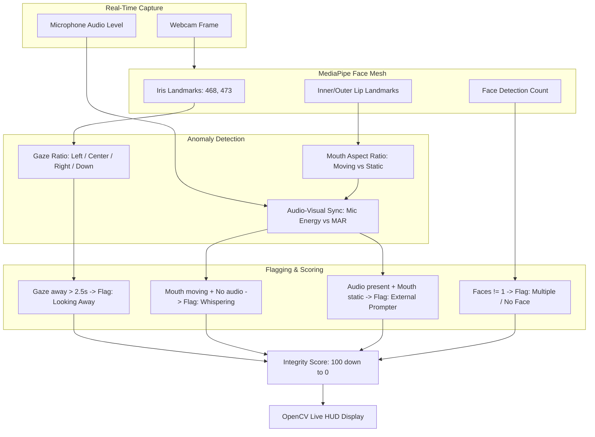

# AI Cheating Detection Interviewer - Rapid Prototype Plan

## 1. Project Goal & Scope
Build a high-impact, standalone **Python Desktop Prototype** that:
1. Takes technical skills via command-line arguments (e.g., `python main.py --skills "Python, FastApi, Machine Learning"`).
2. Uses **Google Gemini API** to generate targeted technical interview questions.
3. The **AI Agent speaks out questions** aloud to the candidate via Text-to-Speech (TTS).
4. Analyzes the candidate's camera & microphone in real time via **OpenCV + MediaPipe**:
   - **Eye Gaze**: Detects when candidate looks away from the screen (reading off second screen or phone).
   - **Lip Movements**: Measures Mouth Aspect Ratio (MAR) to detect lip motion, whispering, or proxy speaking.
   - **Audio-Visual Discrepancy**: Correlates microphone speech with mouth movement (flags whispering without sound or audio without lip movement).
   - **Presence**: Flags when face is missing or multiple people enter the frame.
5. Displays a **high-tech OpenCV HUD** with:
   - Question overlay & interview progress.
   - Live Gaze direction & Lip movement metrics.
   - Real-time **Integrity Score** (100% $\rightarrow$ Decreases on infractions).
   - Instant visual alerts (e.g., `[FLAG: LOOKING OFF-SCREEN]`, `[FLAG: MULTIPLE FACES]`).
6. Saves a **Post-Interview Audit Report** with violation timestamps and candidate integrity rating.

---

## 2. Technical Stack (Minimal & Rapid Prototype)

| Component | Technology | Rationale |
| :--- | :--- | :--- |
| **Language & Runtime** | Python 3.10+ | Single language, native OpenCV/MediaPipe support |
| **LLM (Question Generator)** | **Google Gemini (`google-genai` / `google-generativeai`)** | Fast, high-quality question generation based on skills |
| **Agent Voice (TTS)** | `pyttsx3` | 100% offline, zero latency, runs synchronously or in a background thread |
| **Vision & Face/Eye/Lip Mesh** | `opencv-python`, `mediapipe` | High-accuracy 478 face landmarks (irises + lip contours) in real-time |
| **Audio Energy Detector** | `sounddevice` or `pyaudio` | Lightweight background thread sampling mic amplitude |
| **UI / Display** | OpenCV GUI Window with custom HUD overlay | Zero web server overhead, runs instantly from terminal |

---

## 3. Cheating Detection Logic & Heuristics



### Detection Metrics:
1. **Gaze Direction**:
   - Compare iris center landmark distance to inner/outer eye corners.
   - If horizontal ratio $< 0.35$ or $> 0.65$, or vertical ratio indicates looking down at a desk/phone for continuous frames $\rightarrow$ Trigger Gaze Warning.
2. **Lip Movement (MAR)**:
   - $\text{MAR} = \frac{\text{Vertical lip opening distance}}{\text{Horizontal mouth width}}$.
   - $\text{MAR} > 0.05$ indicates active mouth movement.
3. **Cross-Modal Audio Sync**:
   - **Candidate Whispering**: Lips moving continuously ($\text{MAR} > 0.05$) while mic volume is near zero $\rightarrow$ High probability of whispering to someone.
   - **Third-Party Dictating**: Mic volume high while candidate lips are closed ($\text{MAR} < 0.03$) $\rightarrow$ Someone else in the room is talking.
4. **Presence**:
   - Multiple faces detected in frame $\rightarrow$ Immediate Critical Flag.
   - No face detected for $> 3$ seconds $\rightarrow$ Candidate left screen.

---

## 4. Interview Flow & Architecture

1. **CLI Execution**:
   ```bash
   python main.py --skills "Python, SQL, System Design" --num-questions 3
   ```
2. **Initialization**:
   - Fetch Gemini API key from environment or `.env`.
   - Call Gemini to generate $N$ tailored technical questions based on the skills provided.
   - Initialize Webcam, MediaPipe FaceMesh, and Microphone monitor.
3. **Interactive Question Loop**:
   - **Agent Asks Question**: Agent speaks question using TTS (background thread) while showing the question on the OpenCV HUD.
   - **Candidate Answer Window**: Timer starts (e.g., 45-60 seconds per question).
   - **Continuous Proctoring**: Frame-by-frame analysis of eyes, lips, audio, and face count.
   - **Integrity Score Deduction**: Violations penalize the real-time score and log timestamped infractions.
4. **Interview Wrap-Up**:
   - Agent announces completion.
   - Final Integrity Score and breakdown displayed on screen and saved to `interview_report.json` and a simple markdown report.

---

## 5. Implementation Steps

1. **Step 1: Module Setup & Dependencies**:
   - Define `requirements.txt` (`opencv-python`, `mediapipe`, `google-genai`, `pyttsx3`, `sounddevice`, `numpy`).
2. **Step 2: Eye & Lip Movement Tracker (`detector.py`)**:
   - Build MediaPipe face mesh tracker with gaze ratio, MAR calculation, and audio level monitor.
3. **Step 3: Question Generator & TTS (`interviewer.py`)**:
   - Gemini API prompt for structured questions based on `--skills`.
   - Threaded TTS speaker so speech doesn't freeze the OpenCV video loop.
4. **Step 4: OpenCV HUD & Main Application (`main.py`)**:
   - Sci-Fi / High-tech proctoring HUD: Gaze vector, score bar, alerts, question text, timer.
5. **Step 5: Testing & Verification**:
   - Test camera feed, eye tracking, lip movement, and speech synthesis.
